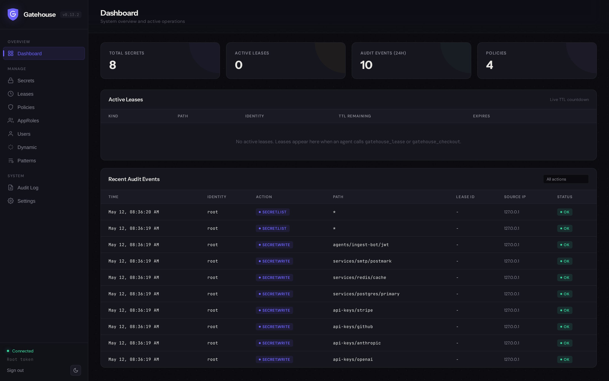
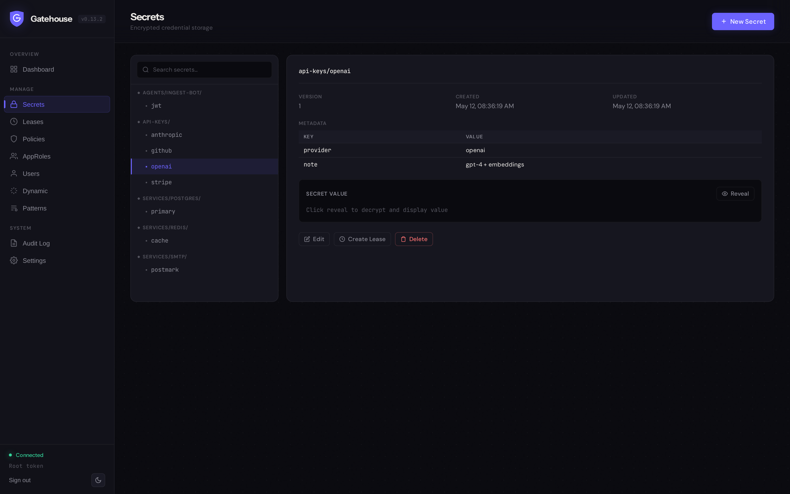
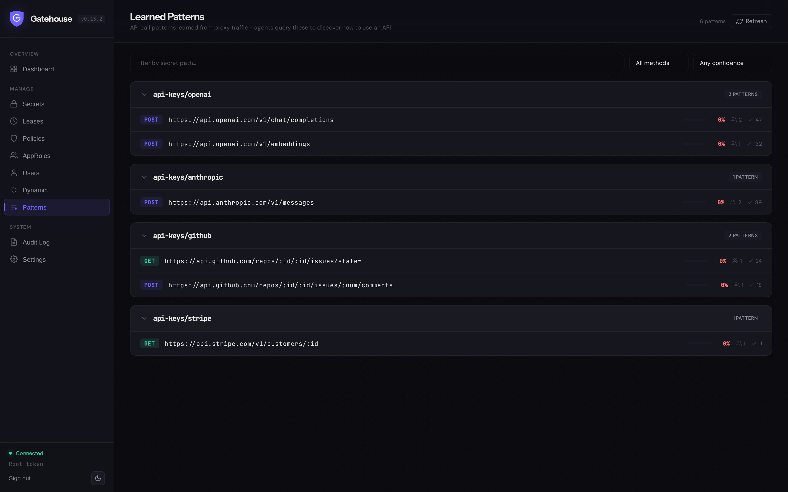

<p align="center">
  
</p>

<h1 align="center">Gatehouse</h1>

<p align="center"><strong>The agent secrets vault. Credentials never leave the vault.</strong></p>

<p align="center">
  <a href="https://gatehouse.to">Website</a> ·
  <a href="https://gatehouse.to/docs/getting-started/">Docs</a> ·
  <a href="#quick-start">Quick start</a> ·
  <a href="CHANGELOG.md">Changelog</a> ·
  <a href="https://github.com/bshandley/gatehouse/pkgs/container/gatehouse">GHCR</a>
</p>

**Gatehouse is a self-hosted secrets vault built for AI agents and LLM tools.** It stores API keys, database credentials, and SSH certificates for autonomous coding agents (Claude Code, Codex, Cursor, Windsurf, OpenCode) and proxies upstream HTTP calls so secrets never enter agent context windows, log files, or tool output. Think of it as an open-source HashiCorp Vault alternative purpose-built for agentic AI: MCP-native, REST-parallel, single Docker container, AGPL-3.0.

Gatehouse is single-instance by design (in-memory rate limiting and an in-process event bus). Run one. It is built for a homelab, not a cluster.

**Install.** Ready-made templates for [Unraid, Umbrel, CasaOS, and Coolify](packaging/) are in `packaging/`. You can use them yourself today. They are not listed in any upstream catalog.

## Why a secrets vault built for AI agents?

Traditional secret managers assume the client is trusted once authenticated. AI agents break that assumption. Their context windows get logged, cached, and shipped to cloud APIs. A credential that enters an agent's memory can end up anywhere.

Gatehouse takes a different approach: **agents don't need to see your credentials at all.** With proxy mode, an agent says *"call this API for me"* and gets back the response. The credential never enters the agent's address space, context window, or tool output. It can't be leaked because it was never there.

Because every proxy call flows through Gatehouse, it also **learns**. Successful requests are recorded as reusable API patterns (method, URL template, header names, request/response schemas) scored by a rolling confidence window. The next agent to touch that secret asks Gatehouse *"how do I call this API?"* and gets back known-good templates verified by other agents, without burning tokens on trial-and-error.

For everything else (leasing, dynamic secrets, SSH certificates, audit logging) Gatehouse gives you Vault-grade capabilities in a single Docker container. No unsealing ceremony, no Consul cluster, no operational overhead.

## What it does

- **Passthrough.** Point any SDK or tool at `/p/<alias>` instead of the real API. Gatehouse injects the key and streams the response back. No code changes.
- **Proxy mode.** Agents send HTTP requests with secret references; Gatehouse injects credentials and forwards upstream. Domain allowlisting prevents exfiltration.
- **Pattern learning.** Successful proxy calls become normalized templates. Agents query them before making a first call, so they stop guessing.
- **Dynamic secrets.** Short-lived credentials for PostgreSQL, MySQL/MariaDB, MongoDB, Redis, and SSH certificates. Configs encrypted at rest.
- **Onboarding links.** Generate a one-time bootstrap URL in the web UI; the agent curls it, exchanges the token, and auto-installs a `gatehouse` skill into its harness. Credentials never appear in chat.
- **MCP + REST.** 11 MCP tools for Claude Code, Codex, Cursor, Windsurf, OpenCode; parallel REST API for everything else.
- **Per-agent identity.** Each agent gets its own AppRole with scoped policies and a full audit trail.
- **Key rotation.** Rotate the master key and re-wrap all DEKs in one API call, zero downtime. You supply the new 64-hex key. Key-file installs get `master.key` rewritten with the old key kept; env installs must set `GATEHOUSE_MASTER_KEY` to the new key before the next restart.
- **Backup and restore.** `backup`, `export`, `import` and `verify` commands ship in the image. A passphrase-sealed export carries the master key, so one file plus one passphrase recovers the vault. First boot generates a key file if you do not supply a key.
- **Web UI.** Dark-themed control panel with command palette (Cmd/Ctrl+K) for managing secrets, leases, agents, patterns, and audit logs.
- **SSO.** Optional OpenID Connect single sign-on for human admins. Works with PocketID, Authentik, Keycloak, Google, and any other OIDC provider. Strict link-by-verified-email account model; configure once in Settings.
- **Rate limits.** Per-AppRole (minute/hour/day) and per-secret (minute) on proxy traffic. Bound damage from a runaway agent or an expensive upstream. 429 with `Retry-After` when hit; root and user JWTs exempt.
- **Approval-gated leases.** Mark a secret `requires_approval=true` and agents must call `gatehouse_request_access` and wait for a human. The approved lease IS the access window: revoke once, atomic kill. Optional signed webhook (HMAC + timestamp) for Slack/Discord/paging bridges. Trusted networks can auto-approve via CIDR allowlist.
- **Homelab-first.** Single Docker container. Runs on a Raspberry Pi, Proxmox LXC, or Jetson Orin Nano. AGPL-3.0.

## Use cases

- **Secrets manager for AI agents.** Give Claude Code, Codex, Cursor, Windsurf, and OpenCode access to API keys and database credentials without putting raw secrets into LLM context windows.
- **Self-hosted Vault alternative.** Replace HashiCorp Vault for homelab and small-team deployments where a single-container, no-cluster vault is enough. Vault-grade envelope encryption, dynamic secrets, leases, and audit logging.
- **MCP secrets server.** Drop into any MCP-aware harness as a tool server. Agents call `gatehouse_checkout`, `gatehouse_proxy`, and `gatehouse_request_access` instead of seeing raw credentials.
- **Homelab credential vault.** Centralize API keys, SSH certificates, and database passwords across Proxmox LXCs, Raspberry Pi clusters, and Jetson boxes. ~50MB image, runs on a Pi.
- **Approval-gated production access.** Mark a secret `requires_approval=true` so humans authorize each lease over a signed Slack/Discord/paging webhook before an agent can use it.
- **Dynamic database credentials.** Issue short-lived PostgreSQL, MySQL/MariaDB, MongoDB, and Redis credentials per agent task; revoke on lease expiry.

## Screenshots

| Dashboard | Secrets | Learned patterns |
|---|---|---|
| [](docs/screenshots/dashboard.png) | [](docs/screenshots/secrets.png) | [](docs/screenshots/patterns.png) |

## Quick start

```bash
docker run -d --name gatehouse -p 3100:3100 -v gatehouse-data:/data ghcr.io/bshandley/gatehouse:latest
docker logs gatehouse   # your master key and one-time bootstrap token
```

Save the master key somewhere off this host. Then open `http://localhost:3100` and sign in with the bootstrap token to create your first admin user. Full walkthrough at [gatehouse.to/docs/getting-started](https://gatehouse.to/docs/getting-started/).

## Passthrough: change a base URL, keep your code

Give a secret an alias and an upstream URL. Any client with a base-URL setting then talks to Gatehouse as if it were the real API, holding a Gatehouse credential instead of the real key:

```bash
# once, as an admin: bind the secret to an alias
curl -fsS -X POST http://localhost:3100/v1/secrets/api-keys/example \
  -H "Authorization: Bearer $GATEHOUSE_ADMIN_TOKEN" \
  -H "Content-Type: application/json" \
  -d "{\"value\": \"$OPENAI_REAL_KEY\", \"metadata\": {\"passthrough_alias\": \"openai\", \"upstream_url\": \"https://api.openai.com\"}}"

# then, anywhere: point the SDK at Gatehouse
export OPENAI_BASE_URL=http://localhost:3100/p/openai/v1
export OPENAI_API_KEY="$GATEHOUSE_PT_KEY"   # gatehouse_pt_..., not the real key
python my_script.py                         # unmodified, streaming included
```

Gatehouse checks the caller's policy, applies rate limits, approvals, and allowlists, injects the real key, and streams the response back with the key scrubbed. Tested with the OpenAI and Anthropic Python SDKs and `curl`; should work with anything else that has a base URL and one API-key slot (the docs include untested n8n and Home Assistant recipes). The alias grants nothing: the caller still needs a policy with `proxy` on the secret. Recipes and limits: [gatehouse.to/docs/passthrough](https://gatehouse.to/docs/passthrough/).

## Proxy mode: the JSON envelope

Agents that speak Gatehouse's protocol (REST or the `gatehouse_proxy` MCP tool) send one envelope naming the secret to inject:

```bash
curl -X POST http://localhost:3100/v1/proxy \
  -H "Authorization: Bearer $GATEHOUSE_TOKEN" \
  -H "Content-Type: application/json" \
  -d '{
    "method": "POST",
    "url": "https://api.openai.com/v1/chat/completions",
    "inject": {"Authorization": "api-keys/example"},
    "headers": {"Content-Type": "application/json"},
    "body": {"model": "gpt-4", "messages": [{"role": "user", "content": "hello"}]}
  }'
```

The agent never sees `api-keys/example`. Gatehouse resolves it server-side, attaches `Authorization: Bearer <value>`, forwards the request, records the pattern, and returns the response.

## Onboarding an agent

Skip pasting `role_id` / `secret_id` into chat:

1. In the web UI, create an AppRole with the policies you want.
2. Click **Onboard** on the row, pick a TTL, copy the generated prompt.
3. Hand the prompt to the agent over any channel.

The agent curls the one-time URL, exchanges the token for rotated credentials, writes them into its harness, and installs a `gatehouse` skill so future sessions know how to use the vault. Details: [gatehouse.to/docs/authentication](https://gatehouse.to/docs/authentication/).

## Docs

Full documentation lives at **[gatehouse.to](https://gatehouse.to)**.

| Page | What's there |
|---|---|
| [Getting Started](https://gatehouse.to/docs/getting-started/) | Install, first admin user, first AppRole. |
| [Core Concepts](https://gatehouse.to/docs/concepts/) | Secrets, policies, leases, proxy, patterns. |
| [Authentication](https://gatehouse.to/docs/authentication/) | AppRoles, user accounts, onboarding links, TOTP. |
| [Web UI Tour](https://gatehouse.to/docs/web-ui/) | Every tab, every button. |
| [Passthrough](https://gatehouse.to/docs/passthrough/) | Base-URL passthrough: recipes for the OpenAI and Anthropic SDKs, curl, n8n, Home Assistant. |
| [Dynamic Secret Providers](https://gatehouse.to/docs/providers/) | PostgreSQL, MySQL, MongoDB, Redis, SSH certificates. |
| [Backup & Recovery](https://gatehouse.to/docs/backup/) | Master key, backup, export, import, verify, restore. |
| [Security & Threat Model](https://gatehouse.to/docs/security/) | What Gatehouse protects, what it doesn't. |
| [API Reference](https://gatehouse.to/docs/api-reference/) | Every REST endpoint and MCP tool. |
| [For Agents](https://gatehouse.to/docs/for-agents/) | Hand this URL to an agent. It's written for them. |
| [Integrations](https://gatehouse.to/docs/integrations/) | Claude Code, Codex, Cursor, Windsurf, OpenCode, Hermes, OpenClaw. |
| [Changelog](https://github.com/bshandley/gatehouse/blob/main/CHANGELOG.md) | Per-release summary; full per-commit log lives in GitHub Releases. |

## Tech stack

Bun + Hono, SQLite (WAL), XSalsa20-Poly1305 envelope encryption with HKDF-SHA256, JWT via jose, MCP over Streamable HTTP / SSE / stdio. Single Dockerfile, ~50MB image.

## License

AGPL-3.0. See [LICENSE](LICENSE).
